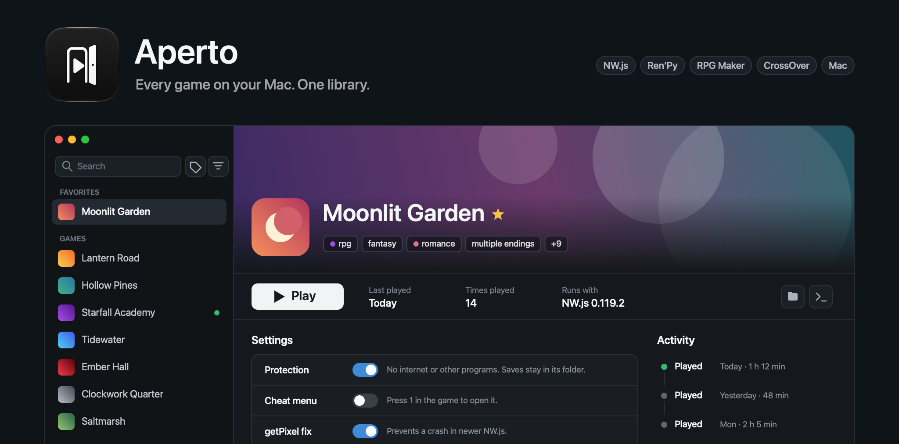

# Aperto



A game library and launcher for Apple silicon Macs. Point it at a folder and it finds NW.js and RPG Maker MV/MZ games, Ren'Py and RPG Maker XP–VX Ace games, Windows games for CrossOver, and Mac apps, then runs each with what it needs. Your files stay where they are. It also installs the games you own on Steam, GOG, and itch.io, links games to their store pages for tags and banners, and opens a coding agent on a game that will not start. This is a source-only project: build and sign your own copy.

> [!WARNING]
> This application was built entirely with gpt-6-astra and Claude Opus. Use it at your own risk.

## Use

- Choose a games folder in Settings. Aperto scans it on launch, when you come back to the window, and when you press the scan button. The + button adds games from any other folder, or from your Steam, GOG, or itch.io library.
- Select a game and press Play, or double-click it in the list. Return plays or stops the selected game.
- Search names, or tags with `tag:horror` or `tag:"rpg maker"`. The tag button beside the search includes or excludes tags; the filter button sorts and filters by type and status.
- Star a game to keep it in Favorites at the top of the list.
- Right-click a game in the list for its actions. Create Shortcut makes a small app in `~/Applications/Aperto Games` that starts the game, so Spotlight, Raycast, Launchpad, and the Dock can too. Copy Link copies its `aperto://play/…` address, which starts it from anywhere that opens links.
- Hover a game's header to change its icon or banner. A Windows game's icon comes from its `.exe`.
- The trash button removes a game from the library, keeping its folder, or deletes it from disk. Shift-click deletes it from disk straight away. A game Steam installed is uninstalled through Steam. Removed games whose folders still exist can be restored in Settings, under Library.

Settings on a game's page save as you change them. Only the name has a Save button. The Settings window has pages for the library, links and tags, store accounts, apps, and runtimes.

## Games

| Kind | Found by | Runs with |
| --- | --- | --- |
| NW.js, RPG Maker MV/MZ | `package.json` | An NW.js runtime from Settings |
| Ren'Py | `renpy`, `game`, and a launcher script | Its own Mac build, or the Ren'Py release it was made with |
| RPG Maker XP, VX, VX Ace | `Game.ini` beside `Game.exe` and RGSS data | mkxp-z, natively |
| Windows | An `.exe` that is not an installer | CrossOver, in a bottle you choose |
| Steam games in CrossOver | Steam's manifests in every bottle | That bottle's Steam, or the bottle directly |
| Mac games from Steam | Mac Steam's manifests in each of its libraries | Mac Steam, or macOS directly |
| Mac apps | App bundles, and apps in `/Applications` filed under games | macOS |

Ren'Py releases, mkxp-z, its compatibility scripts, and RPG Maker RTPs download the first time a game needs them. Settings lists each with its size, and removing one only means it downloads again.

Windows games run like CrossOver's Run Command: nothing is installed in the bottle. Unity games get display and graphics API controls. High resolution mode switches the whole bottle, so Aperto refuses to start a game whose mode differs from one already running there.

Play starts a game Steam installed through Steam, which keeps its updates and DRM working. The arrow beside Play runs it directly instead.

## Protection

NW.js, Ren'Py, and RPG Maker XP–VX Ace games run in a macOS sandbox unless you turn Protection off for a game:

- No internet besides this Mac.
- No other programs and no Apple Events.
- No reading personal files in your home folder.
- Writes only to the game's folder, its Aperto data, and temporary folders.
- No creating files Finder would run, such as `.app` or `.command`.

Turn it off for games that need to go online or save elsewhere. Mac apps and CrossOver games are not sandboxed.

## RPG Maker MV/MZ plugins

A game's page lists its plugins with switches, edited in the game's own `js/plugins.js`. Aperto keeps the original list and can restore it, and stops editing if the list changes outside Aperto.

- **Cheat menu** adds emerladCoder's RPG Maker Cheat Menu. Press 1 in the game to open it.
- **getPixel fix**, on by default, stops a crash in games that read pixels at invalid positions in newer NW.js.

## Stores

Sign in under Settings, Accounts, then open your games from there or from the + button. While something downloads, an icon in the sidebar shows overall progress. Click it to see each download and stop one.

- **Steam** signs in on Steam's own page. Install hands the game to Mac Steam when it has a Mac version, and to the Steam in a CrossOver bottle otherwise. The game joins the library when Steam finishes.
- **GOG** signs in on GOG's own page. Aperto unpacks Mac installers without running them and runs Windows installers silently in the default CrossOver bottle. Either way the game lands in the games folder.
- **itch.io** signs in with an API key from its API keys page. Aperto downloads the Mac build when there is one, else the Windows or web build.
- **DLsite** appears with Adult sexual content on, and signs in on DLsite's own page. Aperto lists the games among your purchases and downloads them into the games folder. Large works come in parts; joining them needs 7-Zip from Homebrew (`brew install sevenzip`).

Aperto links each downloaded game to its store page and adds the page's tags and banner. With Adult sexual content off, the Steam list leaves out games Steam marks as having it. GOG and itch.io do not mark adult games reliably, so their lists show everything.

## Coding agents

If you have Claude Code, Codex, OpenCode, Gemini CLI, or another supported coding agent, the arrow beside the terminal button opens it in the game's folder. Aperto tells it where the game is and how it runs. A failed launch in Activity has a button that asks the agent to fix it, with the error and the end of the game's output.

## Links, tags, and updates

A game's page links it to Steam, GOG, and itch.io, and to F95zone and DLsite once you turn on Adult sexual content in Settings. Linking a game adds that page's tags, and its banner where the site has one. Settings chooses which sites show, and can link every game whose title matches exactly, or add back the tags of every linked game's pages.

In Settings, rename, recolor, merge, or delete tags across the library. Blocked tags are removed from every game and never added again; one click blocks every tag only one game has.

With Adult sexual content on, Aperto compares each game's version twice a day, read from its folder name, with its F95zone thread. Outdated games get a marker in the list and a link to the thread.

## Build and sign

Requires an Apple silicon Mac, macOS 14 or later, Xcode, Node.js 22.12 or newer, pnpm through Corepack, and Python 3. Run from the cloned repository:

```sh
pnpm install
./scripts/run.sh
```

This builds, signs, installs into `/Applications/Aperto.app`, and launches it. Use `./scripts/build.sh` to build and sign without installing, and `pnpm dev` to work on it. CrossOver is only needed for Windows games.

Signing is automatic. The first build creates your own self-signed development certificate in a private keychain under `~/Library/Application Support/Aperto/Signing`. Later builds reuse it. Keep that directory private and intact. No paid Apple Developer account or notarization is needed for this local build. The scripts do not change system certificate trust or your default keychain.

## Data

The library lives in `~/Library/Application Support/Aperto`, with each NW.js game's browser data and backups beside it. When a game's folder is deleted, from Aperto or not, Aperto forgets the game and deletes what it kept for it, on the next scan and each time it starts, so the game downloaded again is added as new. The Keychain encrypts the GOG token and itch.io key. Steam's sign-in stays in Aperto's own browser session. Aperto writes into game folders only for plugin changes, the cheat menu, the getPixel fix, and artwork in a `.aperto` folder: the images the library shows, and copies of artwork you chose.

Downloads are verified before use: NW.js against its signed checksums, mkxp-z against GitHub's recorded SHA-256, and the cheat menu and Kawariki scripts against pinned hashes. Neither of those two is shipped with Aperto; the cheat menu has no license, and Kawariki is GPL-3.0.

## License

[MIT](LICENSE).

## Why can't I just download the binary?

Because I'm not paying Apple $100 a year for this shit. That's what Developer ID signing and notarization would cost, even for a free app. I could ship an unnotarized binary, but you'd still have to deal with macOS security warnings.

Once the build tools above are installed, run `./scripts/run.sh` and you have the app ready. You also get all the source code, so you can see what it does and change whatever you want.
